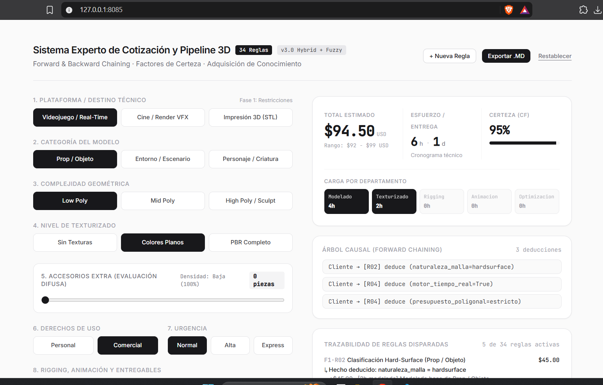
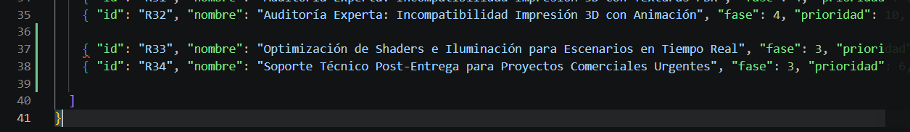

# Sistema Experto de Cotización de Modelado 3D

## Problema
Este sistema experto resuelve el problema de la estimación de costos, tiempos técnicos por departamento en proyectos de modelado 3D (videojuegos, cine/VFX e impresión 3D). Utiliza un motor de inferencia sobre una base de conocimientos en JSON.

## Cómo se Ejecuta
1. Abrir una terminal en la carpeta raíz del proyecto.
2. Ejecutar el comando: python main.py

## Reglas agregadas en el Parcial 2
* **Regla R33:** SI `categoria == "entorno"` Y `destino == "videojuego"` ENTONCES sumar 3h de optimización y +$45.00 USD por Baking de Lightmaps y configuración de colisiones.

* **Regla R34:** SI `uso == "comercial"` Y `urgencia == "express"` ENTONCES sumar 2h de optimización y +$35.00 USD por Garantía de soporte técnico directo para integración comercial urgente.

